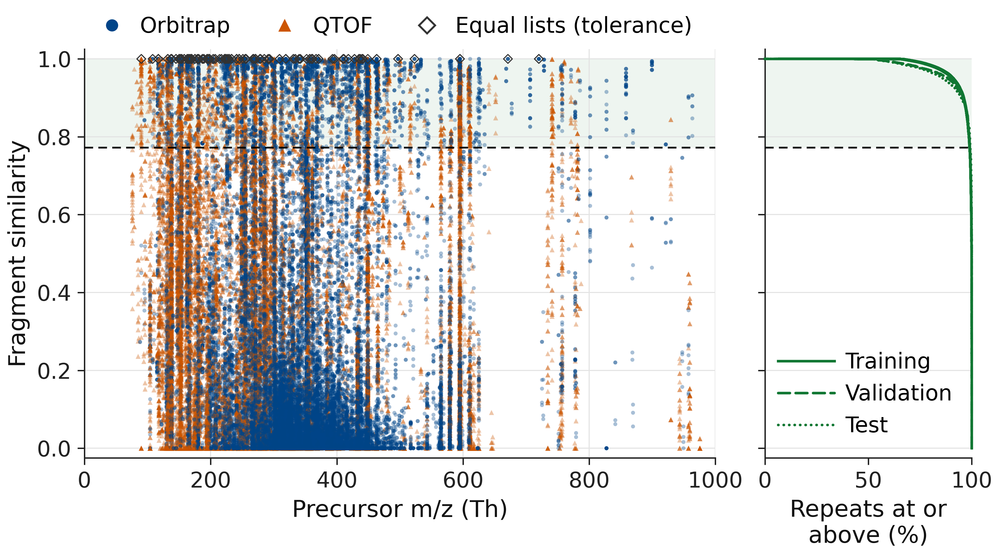
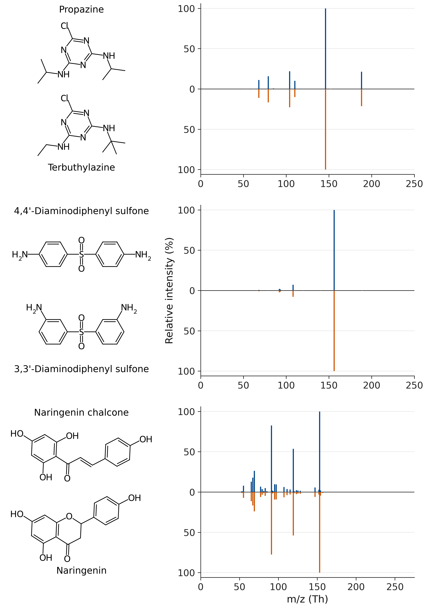
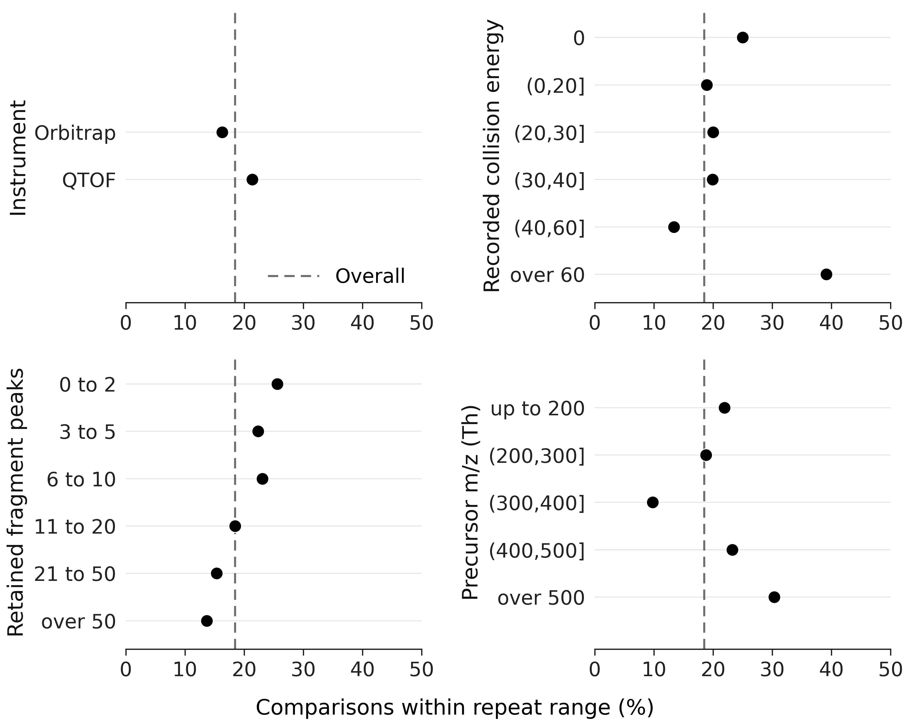
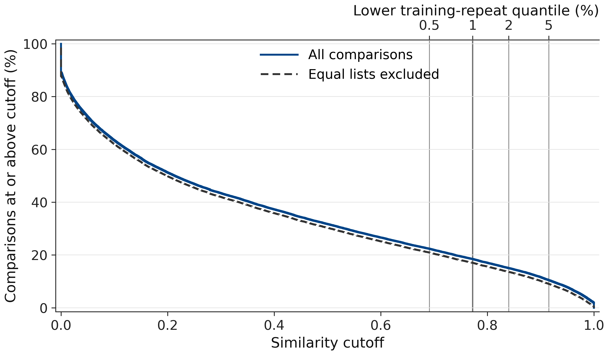

# 11,554 isomer comparisons that look like repeats

Tandem mass spectrometry (MS/MS) helps identify small molecules, such as drugs and metabolites, in biological and environmental samples by giving them an electrical charge, selecting an ion by mass, breaking it through gas collisions and recording the fragment masses and intensities as a spectrum. MassSpecGym is an open benchmark for methods that identify molecular structures from these spectra. The isomers studied here have the same molecular formula but different atom connections, so their original mass alone cannot distinguish them. We compared their fragment spectra using a similarity score: **11,554 of 62,535 isomer comparisons (18.5%)** fall inside the range set by repeated measurements of the same molecule.

Use these measured spectra to test structure-identification methods and find pairs worth measuring again.

The shaded band begins at the repeat cutoff; diamonds mark full peak lists that are equal within numerical tolerance. Every comparison is drawn, including points that overlap.

## Different structures, nearly matching fragments

These selected pairs share a formula and recorded condition, but have different full peak lists. Each spectrum's strongest retained peak is set to 100%; the [vector image](figures/isomer-examples.svg) reveals details too small to see here.

| Pair, upper / lower spectrum | Instrument; recorded energy | Similarity |
|:--|:--|--:|
| Propazine / terbuthylazine | Orbitrap; 60 | 0.99886 |
| 4,4'- / 3,3'-diaminodiphenyl sulfone | Orbitrap; 15 | 0.99868 |
| Naringenin chalcone / naringenin | QTOF; 55 | 0.99778 |

All use [M+H]+. [Pair identities](data/example_pairs.csv), [structures](data/example_spectra.csv) and [complete peak lists](data/example_peaks.csv) are included.

## Where overlap occurs

Overlap is **16.28% on Orbitrap** and **21.37% on QTOF**, using each category's own count. The dashed line is the overall share; [all category counts](results/README.md) are included.

## How much depends on the cutoff

Changing the lower repeat quantile from **0.5% to 5%** moves overlap from **22.38% to 10.46%**. Removing numerically equal lists leaves **10,657 comparisons (17.04%)** at the main cutoff, keeping the original denominator as both curves do.

## What this does not show

- Overlap under this score does not prove that structures are indistinguishable: another similarity, fine intensity differences or another measurement may separate them.
- This is a selected part of one library, not a population estimate: instrument and energy are recorded for **52.7%** of spectra, and stereoisomers share a molecule key.
- Both molecules must occur under the same recorded condition, but the best reference can come from another condition. This happens in **47.5%** of flagged comparisons; energy values are not a shared scale across instruments.
- Comparisons are dependent and favour heavily measured molecules. Duplicate lists and possible annotation errors remain; the three examples are selected illustrations.

[Definitions and assumptions](REPRODUCE.md#exact-definitions), [alternative denominators and repeat agreement](results/README.md), and [figure details](figures/README.md) give the full qualifications.

## How to use it

Load the [comparison tables](data/README.md) to identify each query, its best-matching isomer reference and its score. They contain measured spectra and scores, with no prediction model.

After [installing the dependencies](REPRODUCE.md#install), run the [offline result check](REPRODUCE.md#check-the-included-evidence) to regenerate [summary.json](results/summary.json) and check every reported result against fixed expectations. [REPRODUCE.md](REPRODUCE.md) also covers public-input recomputation and figure regeneration.

Port the [matcher and calibration](ms2/README.md) to another library using the documented definitions and assumptions.

The full computation passed on clean Linux, including both result checks and all **12 tests**. A separate macOS download verified the public file's hash; [verification details](REPRODUCE.md#verification) record the small platform differences.

In a fresh environment built from [requirements-figures.txt](requirements-figures.txt), the data export and all four renderers succeeded in about **19 seconds** in total. The regenerated PNGs are pixel-identical to the published ones; file sizes differ only through PNG encoding.

Code, text, figures and derived results are free to reuse under [CC0 1.0](LICENSE); the tables retain [MassSpecGym's MIT notice](data/MassSpecGym-LICENSE.txt). Credit: R. Bushuiev and colleagues, [*MassSpecGym: A benchmark for the discovery and identification of molecules*](https://arxiv.org/abs/2410.23326), NeurIPS Datasets and Benchmarks Track; [dataset](https://huggingface.co/datasets/roman-bushuiev/MassSpecGym) and [source project](https://github.com/pluskal-lab/MassSpecGym).
