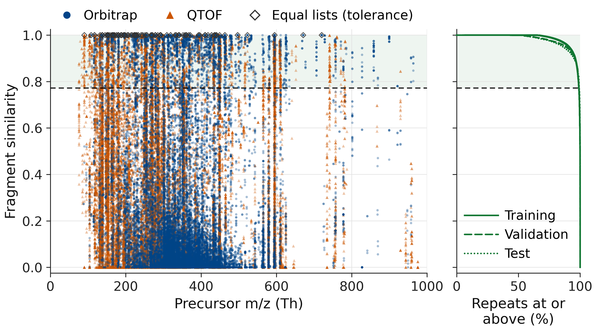
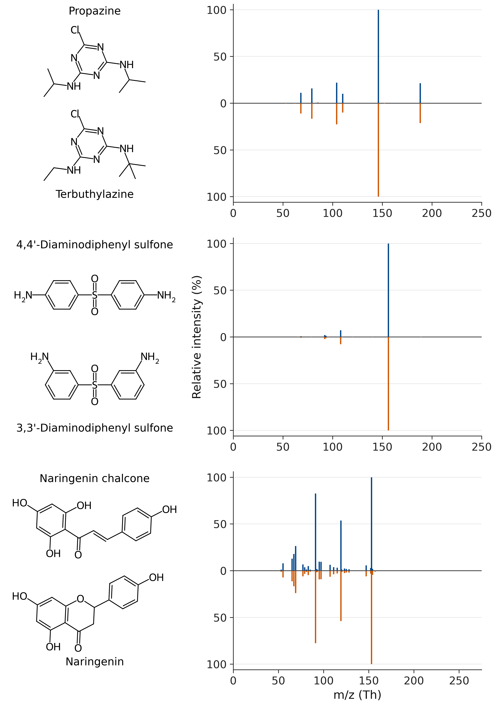
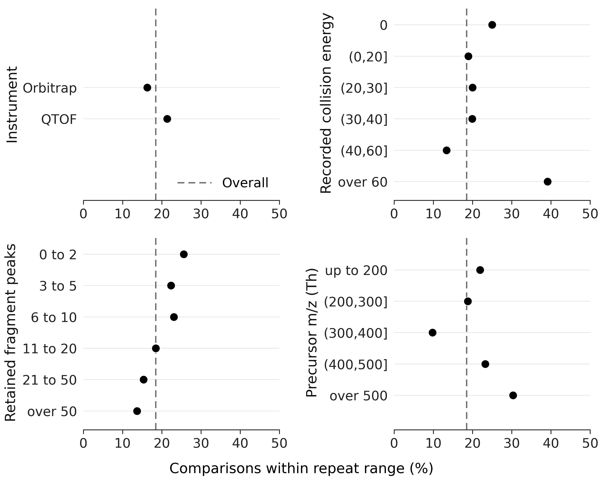
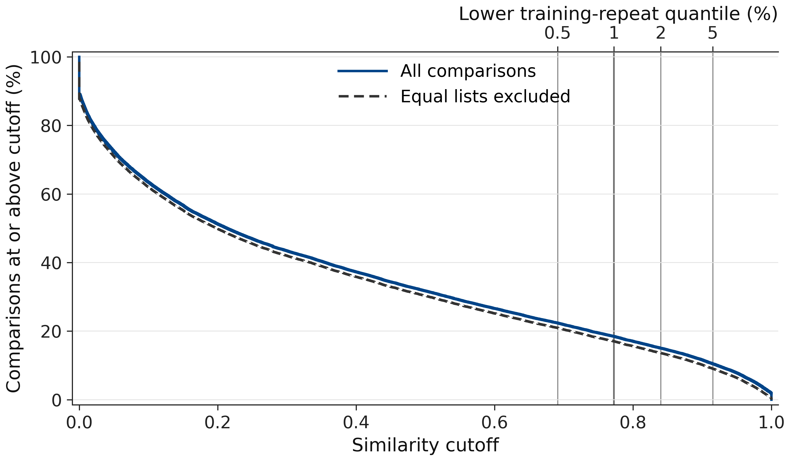

# Read and regenerate the figures

The four figures show the full comparison field, three molecular examples, measurement subsets and cutoff sensitivity. All use the [included evidence](../data/README.md); [regeneration commands](../REPRODUCE.md#regenerate-the-figures) and [rendering code](../render/README.md) are part of this repository.

## Full comparison field

**11,554 of 62,535 comparisons** enter the shaded range defined by training repeats. Diamonds identify full peak lists that are equal within numerical tolerance.

Every unit is drawn in query/reference-key order, including coincident points. Instrument type is shown by both shape and colour. Translucency reveals dense regions, but isolated points have less than 3:1 contrast against white, so the plot is not a substitute for the [score table](../data/isomer_units.parquet).

The horizontal rule is the lower 1% training-repeat quantile. Shading marks the cutoff range, not an uncertainty interval. Each repeat curve uses its own fold's denominator and includes every empirical step. Scores slightly above one from floating-point arithmetic are clipped only for drawing; stored values are unchanged.

## Molecular examples

The three selected pairs score **0.99886**, **0.99868** and **0.99778**, respectively. Each pair shares its formula and recorded condition, with different full peak lists.

These are illustrations, not a random sample or an estimate of prevalence. Sticks show retained relative intensities, with each spectrum's maximum set to 100%; the upper spectrum is the query and the lower spectrum is its reference. The three rows have separate mass ranges ending at 250, 250 and 275 Th. The weakest peaks are too short to distinguish at README size, so inspect the [vector figure](isomer-examples.svg) or [complete peak lists](../data/example_peaks.csv) for fine differences.

RDKit draws the supplied [SMILES](../data/example_spectra.csv) with a common bond length. Each lower structure is aligned to the substructure it shares with the upper one; matching Kekule forms improve comparison without changing connectivity, which the renderer checks. [Pair identities, conditions and scores](../data/example_pairs.csv) remain available separately.

## Measurement subsets

Each point uses its category's own denominator; the dashed line is the overall share. All categories are shown, including recorded energy zero.

Recorded energies are used as supplied and are not a common physical scale across instruments. Fragment counts exclude the precursor region. These are descriptive subsets of one library, not causal effects or population estimates; [category counts](../results/README.md) and a [vector figure](overlap-by-measurement.svg) are included.

## Cutoff sensitivity

Both curves keep the original **62,535-comparison** denominator, leaving **17.04%** at the main cutoff when equal lists are excluded. Changing the lower repeat quantile from **0.5% to 5%** moves the all-comparison share from **22.38% to 10.46%**.

Lines follow every empirical step without smoothing, including ties at a cutoff. The second curve excludes lists equal within the [duplicate tolerance](../REPRODUCE.md#exact-definitions), not just exactly equal lists. Removing those units from the denominator as well gives **17.29%** at the main cutoff; [full counts and cutoffs](../results/summary.json) are included.

## Files and display limits

All PNGs are opaque RGB images, 3,600 pixels wide at 450 dpi. The atlas and sensitivity plot are supplied as PNGs to preserve their dense point and step rendering; the examples and breakdowns also have SVG versions. Some SVG viewers draw the large sensitivity paths incorrectly, so its renderer offers PNG only.

Colour meanings are local to each figure: blue denotes Orbitrap in the atlas, the upper spectrum in the examples and all comparisons in the sensitivity plot. Shape, position or line style supplies a second cue. Labels were checked at a display width of 800 pixels; numerical and layout checks are written to `figures/audit/` when the figures are regenerated. These checks do not certify accessibility at every display size.
