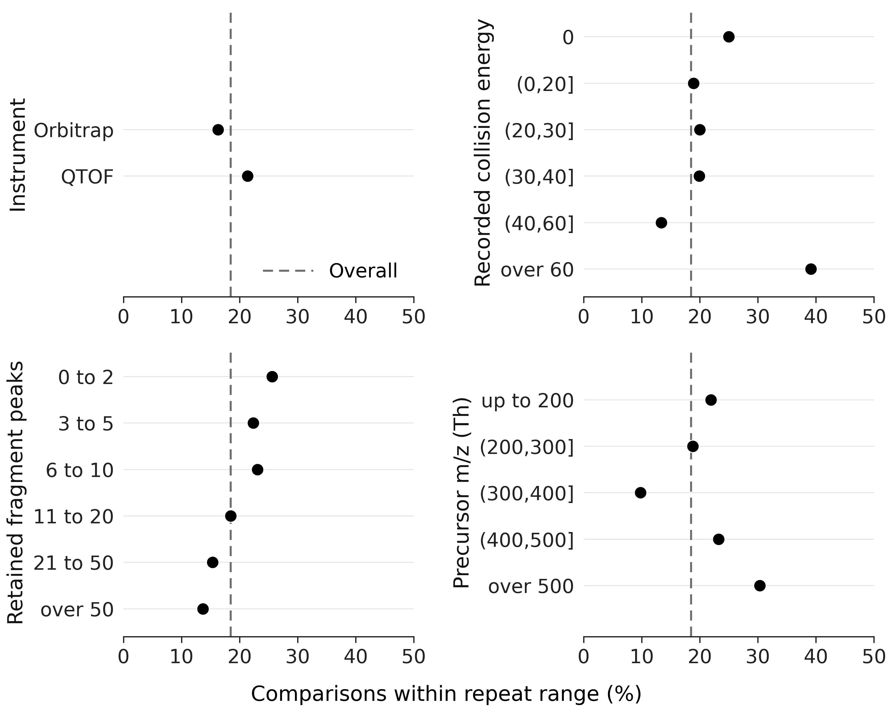
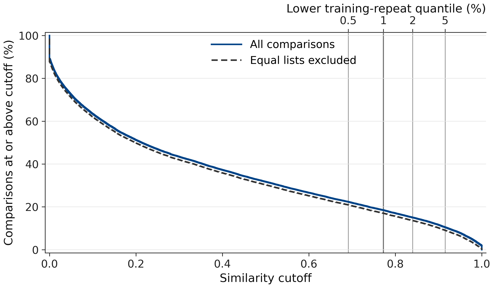

# Check the share, change the denominator

Use these results to distinguish library-wide overlap from a particular instrument, condition or molecule pair. [summary.json](summary.json) contains the full-precision fractions, numerators, denominators and fixed-reference checks, regenerated by `ms2.results` from the included tables. The percentages below are rounded for reading.

The headline is **11,554 of 62,535 units, or 18.476%**. The cutoff is **0.7724635521617974**, set by the lower **1%** of **62,328** training-repeat scores. Validation retains **98.94% of 3,304** repeats; test retains **99.23% of 3,500**.

Every point uses its own denominator. The dashed line uses all comparisons; the categories describe the library rather than causal effects of changing a measurement.

| Query measurement | Units | Within repeat spread |
|:--|--:|--:|
| Orbitrap | 35,571 | 16.28% |
| QTOF | 26,964 | 21.37% |
| [M+H]+ | 62,069 | 18.49% |
| [M+Na]+ | 466 | 16.52% |
| Recorded energy 0 | 72 | 25.00% |
| Recorded energy (0,20] | 29,378 | 18.91% |
| Recorded energy (20,30] | 7,779 | 20.00% |
| Recorded energy (30,40] | 6,396 | 19.90% |
| Recorded energy (40,60] | 16,503 | 13.39% |
| Recorded energy above 60 | 2,407 | 39.14% |
| Fragment peaks 0 to 2 | 3,187 | 25.64% |
| Fragment peaks 3 to 5 | 6,618 | 22.35% |
| Fragment peaks 6 to 10 | 10,611 | 23.08% |
| Fragment peaks 11 to 20 | 15,087 | 18.49% |
| Fragment peaks 21 to 50 | 18,834 | 15.38% |
| Fragment peaks over 50 | 8,198 | 13.70% |
| Precursor m/z up to 200 | 11,682 | 21.92% |
| Precursor m/z (200,300] | 14,764 | 18.78% |
| Precursor m/z (300,400] | 19,696 | 9.77% |
| Precursor m/z (400,500] | 9,534 | 23.23% |
| Precursor m/z above 500 | 6,859 | 30.33% |

Energy is used as recorded, not converted between instruments. The **72 units** at zero are shown separately from the positive-energy bands. Fragment counts exclude the precursor region. Adduct rows are included in the table but are not a panel in the figure. These are descriptive subsets of this library, not estimates for all molecules or instruments.

| Molecule folds, unordered | Units | Within repeat spread |
|:--|--:|--:|
| train / train | 54,106 | 20.71% |
| val / val | 861 | 13.01% |
| test / test | 932 | 21.89% |
| test / train | 2,912 | 0.52% |
| train / val | 2,913 | 0.51% |
| test / val | 811 | 0.49% |

The split deliberately separates structurally distant molecules across folds. Per query fold, the shares are **19.67% of 57,043 training units**, **4.49% of 2,718 validation units**, and **7.71% of 2,774 test units**. Cross-fold comparisons explain the lower validation and test shares. All folds are included; the cutoff alone uses training data.

| Counting rule | Denominator | Share |
|:--|--:|--:|
| Unordered pair, any unit within | 6,949 pairs | 17.33% |
| Unordered pair, at least half within | 6,949 pairs | 13.12% |
| Unordered pair, all within | 6,949 pairs | 7.57% |
| Ordered pair, any unit within | 13,898 pairs | 16.44% |
| Ordered pair, at least half within | 13,898 pairs | 13.41% |

Pair summaries reduce the influence of heavily measured molecules, though each pair's verdict still depends on its available spectra.

The curves use all stored scores without smoothing. Both keep the original unit denominator; the top axis identifies the training-repeat quantiles below.

| Lower repeat quantile | Cutoff | Units within |
|:--|--:|--:|
| 0.5% | 0.6913 | 22.38% |
| 1% | 0.7725 | 18.48% |
| 2% | 0.8402 | 15.03% |
| 5% | 0.9154 | 10.46% |

The tolerance-based duplicate flag covers **897 units**, **1.43%** of all units and **7.76%** of within-spread units, across **128 pairs**. Removing them leaves **10,657 / 62,535 (17.04%)**, or **10,657 / 61,638 (17.29%)** if the denominator also excludes them. **889** flagged units have exactly equal normalised lists; the remainder satisfy the stated numerical tolerance. A further **1,165** unflagged units score at least **0.99**. Library annotation errors have not been audited individually.

The best reference falls outside the query's recorded condition for **47.5%** of within-spread units. Query-side repeat agreement is **83.71% over 29,782 ordered cases** conditional on the first verdict being within, and **95.68% over 112,142** conditional on it being outside. These counts describe dependent repeated observations, not independent trials.

Instrument and energy are recorded for **121,707 / 231,104 spectra (52.7%)**. The isomer comparisons use **33,114 query spectra**, covering **6,316 molecule keys** and **2,260 formulas**; eligibility also requires a same-condition isomer. All spectra are positive mode, and stereoisomers share a molecule key. Overlap is specific to this fragment similarity; it does not establish that every method or additional measurement would fail. See [the exact definitions](../REPRODUCE.md) before interpreting a subset.

The `examples` entries in [summary.json](summary.json) reproduce the displayed pair scores: **0.99886** for propazine/terbuthylazine, **0.99868** for the diaminodiphenyl sulfones and **0.99778** for naringenin chalcone/naringenin. Their [identities, conditions and peak counts](../data/example_pairs.csv) are checked with the same command. They are selected illustrations, not an estimate of how frequently such close matches occur.
